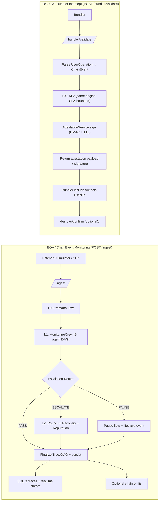
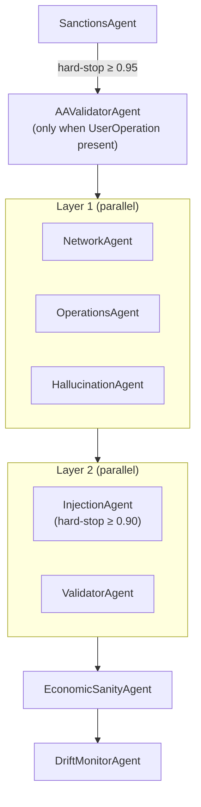
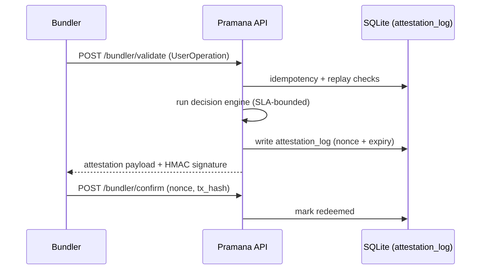

# Pramana Documentation

_Last updated: 2026-04-14_

Pramana is a runtime interception and governance layer for autonomous on-chain agents. It screens proposed actions under tight latency budgets, records an explainable execution trace, and can couple decisions to on-chain registries for accountability.

Pramana supports **two ingress pipelines** that share the same L0/L1/L2 decision engine:
- **EOA / ChainEvent monitoring** (`POST /ingest`): used by listeners, simulators, dashboards, and non-ERC-4337 agent actions.
- **ERC-4337 / Bundler pre-inclusion** (`POST /bundler/validate`): used by bundlers to validate `UserOperation`s before inclusion and receive a signed attestation.

The sections below describe the current codebase behavior. Legacy narrative material that no longer matches the implementation is preserved under **Archive**.

## Project Overview

Pramana sits between an agent’s intent and chain execution. Instead of relying on a single “judge,” it runs a deterministic L1 screening DAG to collect multiple, independent safety signals (sanctions, AA validity, injection patterns, economic sanity, behavioral drift) and fuses them into a calibrated risk score. Only borderline cases escalate to an L2 council, keeping the common path bounded and predictable.

Every decision produces cryptographic provenance: a deterministic `TraceDAG` is finalized into a SHA-256 `trace_hash`, persisted for auditability, streamed to the UI in realtime, and optionally emitted on-chain. For ERC-4337 bundlers, Pramana additionally returns an HMAC-signed attestation with block-based TTL and replay protection.

## System Architecture (L0/L1/L2)

### Two runtime pipelines (EOA vs AA)



Notes:
- `POST /guard/check` is an ultra-fast pre-action hook used by SDK integrations; it runs an injection check synchronously and returns an allow/block decision. It is intentionally narrower than the full L0/L1/L2 pipeline.
- Storage is split by responsibility: SQLite is the operational store (events, traces, agents, attestations), DuckDB is the analytics feedback loop (agent_metrics, reputation_history), and Chroma is used for vector similarity when enabled.

### L0 (Orchestration + persistence)

- **Primary module**: `core/flow.py` (`PramanaFlow`)
- **API entrypoints**: `core/app.py` (`/ingest`, `/guard/check`, `/bundler/validate`, `/bundler/confirm`)
- **Persistence**: `core/db.py` (SQLite + DuckDB)
- **Realtime telemetry**: `core/realtime.py` + `/ws/stream` and `/metrics/realtime`

L0 responsibilities are: ingest/normalize input, initialize `PramanaState` and `TraceDAG`, run L1 screening, route to PASS/ESCALATE/PAUSE, finalize the trace hash, persist to storage, publish telemetry, and perform optional on-chain writes.

### L1 (Deterministic screening: 9-agent DAG)

L1 is intentionally deterministic: **no Groq calls** occur in L1. Each L1 agent follows a two-pass pattern (`check()` then optional `verify()` when the score is borderline) via `core/agents/base.py`.

Current execution DAG (parallel where safe, hard-stops first):



### L2 (Escalation + intervention crew)

- **Council**: `core/agents/council.py` (3 judges, weighted 2/1/1, deterministic fallback when Groq is unavailable)
- **Recovery**: `core/agents/recovery.py` (playbook-driven mitigations)
- **Reputation**: `core/agents/reputation.py` (DuckDB-backed aggregation + optional SBT update)
- **On-chain write path**: `core/crews/intervention.py` writes council outcomes to the Orchestrator registry; `core/flow.py` can emit `TraceFinalized`.

## Agent Inventory (Current L1 = 9 deterministic agents)

| Layer | Agent | Purpose (high-level) | Implementation |
|---|---|---|---|
| Hard-stop | `sanctions` | OFAC/AML sanctions screening over all decoded addresses | `core/agents/sanctions.py` |
| Hard-stop (AA only) | `aa_validator` | ERC-4337 `UserOperation` structure + paymaster/sender solvency checks | `core/agents/aa_validator.py` |
| Parallel | `network` | Gas spikes, RPC/infra health | `core/agents/network.py` |
| Parallel | `operations` | Action loops, balance drain heuristics | `core/agents/operations.py` |
| Parallel | `hallucination` | Off-policy behavior: patterns + vector similarity + historical success | `core/agents/hallucination.py` |
| Parallel | `injection` | Prompt-/transaction-injection pattern detection | `core/agents/injection.py` |
| Parallel | `validator` | Schema validation + deterministic structural checks | `core/agents/validator.py` |
| Sequential | `economic_sanity` | DeFi/economic sanity checks with deterministic 2nd-pass cross-check | `core/agents/economic_sanity.py` |
| Sequential | `drift_monitor` | Per-agent drift vs baseline, Chroma-backed when enabled | `core/agents/drift.py` |

## Core Algorithms (Evidence-Based)

### 1) Two-pass deterministic L1 checks

All L1 agents inherit from `core/agents/base.py`:
- Pass 1 (`check()`): fast, bounded work.
- Pass 2 (`verify()`): only when score is borderline (default band: 0.60–0.80), still deterministic.

Infrastructure failures are treated as **degraded signals** (flagged with a neutral score) so that “unknown” routes to escalation rather than a false clean pass.

### 2) Risk fusion across heterogeneous signals

L1 outputs are fused into a single risk score in `core/crews/intervention.py` as a weighted average plus two correction terms:

$$

\mathrm{base} = \frac{\sum_i w_i s_i}{\sum_i w_i}
$$

$$
\mathrm{fused} = \mathrm{clip}_{[0,1]}(\mathrm{base} + \mathrm{densityBonus} + \mathrm{uncertaintyPenalty})
$$

This improves stability by (a) rewarding agreement across independent detectors and (b) penalizing “skipped”/missing signals in degraded modes.

### 3) Deterministic TraceDAG provenance (SHA-256)

The canonical trace object is `utils/graph.py` (`TraceDAG`). L0 finalization computes a deterministic adjacency-list JSON and hashes it (SHA-256) into `trace_hash`, which is persisted and can be emitted on-chain.

### 4) ERC-4337 attestations (HMAC + replay protection)

`core/attestation.py` signs bundler decisions with HMAC-SHA256, binds them to `user_op_hash`, and enforces replay protection through the SQLite `attestation_log`. TTL uses block-based expiry when RPC is available, with a compatibility fallback to wall-clock time.



---

## Archive: Comprehensive Review (Legacy — does not match current code)

<details>
<summary>Click to expand archived content (kept for historical context)</summary>


# PRAMANA: Autonomous Agent Monitoring & Governance Platform - Comprehensive Review

## Table of Contents
1. [Project Overview & Objective](#project-overview--objective)
2. [System Architecture: L0, L1, L2](#system-architecture-l0-l1-l2)
3. [Complete Agent Inventory & Task Distribution](#complete-agent-inventory--task-distribution)
4. [Core Algorithms & Working Principles](#core-algorithms--working-principles)
5. [Why This Approach is Optimal](#why-this-approach-is-optimal)
6. [Blockchain Integration & Security Model](#blockchain-integration--security-model)
7. [Improvement Recommendations](#improvement-recommendations)
8. [Building & Testing 10 Agents on Sepolia](#building--testing-10-agents-on-sepolia)
9. [Pramana vs Portkey: Feature Comparison](#pramana-vs-portkey-feature-comparison)

---

## Project Overview & Objective

### What is Pramana?

Pramana is a **deterministic, multi-tier autonomous agent monitoring and governance platform** designed to prevent catastrophic failures (hacks, hallucinations, drift, economic irrationality) from off-chain agents executing on-chain (executing blockchain transactions). It operates as a real-time safety verification layer that sits between agent decision logic and blockchain execution.

### Core Objective

Monitor deployed autonomous agents across multiple blockchains, detect behavioral anomalies in real-time, vote on pause/allow decisions via a decentralized council, and emit cryptographic proofs of agent behavior to on-chain registries (Orchestrator smart contract, ReputationSBT).

### Project Flow (High-Level)

```
ChainEvent (tx from agent)
    ↓
[L0: PramanaFlow Orchestrator]
    ├─ ingest_event() → Initialize TraceDAG
    ├─ run_l1_crew() → 7 deterministic agents (parallel computation, sequential execution)
    │   ├─ Network Agent (gas spike, RPC health)
    │   ├─ Operations Agent (action frequency, balance drain)
    │   ├─ Hallucination Agent (semantic drift via embeddings)
    │   ├─ Injection Agent (OWASP LLM Top 10 patterns)
    │   ├─ Validator Agent (schema + dry-run simulation)
    │   ├─ Economic Sanity Agent (12 DeFi parameters)
    │   └─ Drift Monitor Agent (behavior baseline comparison)
    ├─ escalation_router() → Decision tree (O(1) dict lookup)
    └─ [IF escalation needed]
        └─ run_l2_council() → Groq-powered 3-judge vote
            ├─ Judge 0: strict (temp=0.1)
            ├─ Judge 1: moderate (temp=0.5)
            ├─ Judge 2: permissive (temp=0.9)
            └─ Weighted majority verdict (approve/pause/emergency)
    ├─ finalize_trace() → SHA-256 deterministic TraceDAG
    └─ emit_on_chain() → Write to Orchestrator + ReputationSBT (fire-and-forget)

Result: Decision (PASS/PAUSE/EMERGENCY) + Risk_Score [0.0-1.0] + Trace
```

### Purpose

- **Safety**: Prevent agents from executing harmful, off-policy, or economically irrational transactions
- **Transparency**: Emit on-chain proofs of agent reasoning for auditing and accountability
- **Accountability**: Maintain decentralized reputation registry (SBT) for agent performance
- **Governance**: Enable DAOs to pause misbehaving agents via council voting, not by trusting single oracles

---

## System Architecture: L0, L1, L2

### Level 0: PramanaFlow (Top-Level Orchestrator)

**Location**: `core/flow.py`

**Role**: CrewAI Flow[PramanaState] orchestrator that sequences all higher tiers.

**Key Components**:
- `ingest_event()`: Receive ChainEvent, initialize TraceDAG (NetworkX directed graph), persist to SQLite
- `run_l1_crew()`: Execute all 7 L1 agents, aggregate results into PramanaState
- `escalation_router()`: Route to Pass/Escalate/Pause based on flag count and risk score
- `run_l2_council()`: Call InterventionCrew if escalation triggered
- `finalize_trace()`: Commit TraceDAG to DuckDB, compute trace_hash (SHA-256), optionally write to chain
- `emit_on_chain()`: Fire-and-forget transaction to Orchestrator.recordCouncilDecision()

**Design Pattern**: Two-state machine
- State 1 (Normal): L1 only, output Pass/Escalate within 430ms
- State 2 (Escalation): L1 + L2 Council, output final decision via 3-judge vote

### Level 1: Monitoring Crew (Deterministic, No LLM)

**Location**: `core/crews/monitoring.py`

**Role**: Real-time behavioral anomaly detection via 7 fast, deterministic agents.

**Execution Model**:
- Sequential execution (one after another)
- Hard-stop rule: If InjectionAgent flags with score >= 0.90, skip remaining agents
- Each result added to TraceDAG
- Latency budget: ~430ms total (target: all agents complete in <500ms for API responsiveness)

**Agent Order** (critical path defined by risk severity):
1. **NetworkAgent** (30ms) → Detects gas spikes, RPC failures
2. **OperationsAgent** (30ms) → Detects action loops, balance drains
3. **HallucinationAgent** (100ms) → Detects semantic drift via Chroma embeddings
4. **InjectionAgent** (20ms) → Detects OWASP LLM Top 10 attack patterns (hard-stop if flagged)
5. **ValidatorAgent** (50ms) → Schema validation + eth_call dry-runs
6. **EconomicSanityAgent** (120ms) → 12 DeFi sanity checks (oracle staleness, slippage, etc.)
7. **DriftMonitorAgent** (80ms) → Compares current behavior vs baseline (10-tx rolling window)

**Result Format**: L1Result (flagged: bool, score: [0.0-1.0], reason: str, latency_ms, metadata)

### Level 2: Intervention Crew (LLM-Enhanced Decision)

**Location**: `core/crews/intervention.py`

**Role**: Escalated decision-making via Groq-powered council of judges.

**Components**:
- **CouncilAgent**: Runs 3 sequential Groq calls (judges with different temperatures)
  - Judge 0 (Strict): temp=0.1, weight=0.5 → Risk-averse, conservative
  - Judge 1 (Moderate): temp=0.5, weight=1.0 → Balanced
  - Judge 2 (Permissive): temp=0.9, weight=0.3 → Permissive
  - Each judge receives L1 evidence (flags, scores, trace_hash) and votes Approve/Reject
  - Weighted majority: (vote0*0.5 + vote1*1.0 + vote2*0.3) / 1.8 → binary decision
  
- **RecoveryAgent**: Executes failure playbooks (e.g., groq_rate_limit: switch to DuckDB fallback, disable LLM)
  
- **ReputationAgent**: Updates agent metrics (success_rate, halluc_rate, uptime_score), batch-updates on-chain SBT

**Fallback Logic**:
- If Groq rate-limited (3 consecutive failures), RecoveryAgent triggers DegradedMode.NO_LLM
- All L1 agents still run, but L2 council votes deterministically (no LLM)
- ReputationAgent continues recording, syncs to SBT on next healthy window

---

## Complete Agent Inventory & Task Distribution

### Level 1 Agents (Deterministic)

#### 1. NetworkAgent
**File**: `core/agents/network.py`

**Purpose**: Detect blockchain and RPC infrastructure failures.

**Check (First Pass)**:
- Gas price spike detection: current_gas > avg_gas * 2.0 (threshold configurable)
- RPC node reachability: eth_call request with 1s timeout
- Metadata collection: track average gas over 20-tx rolling window via DuckDB

**Algorithm**:
```
if gas_gwei > THRESHOLD * historical_avg:
  score = min(0.5 + (spike_ratio - 2.0) * 0.1, 1.0)  // scales spike into [0.5, 1.0]
if not node_healthy:
  score = 0.85  // RPC failure is high-risk
return L1Result(flagged=(score >= 0.50), score=score, ...)
```

**Verify (Second Pass)** [triggered if 0.60 <= score <= 0.80]:
- Retry RPC ping with 3s timeout (vs 1s in first pass)
- Recheck gas history for stale data
- If reachable, lower score by 0.10 (false alarm recovery)

**Why**: Prevents false pause from transient network blips while catching real infrastructure attacks.

---

#### 2. OperationsAgent
**File**: `core/agents/operations.py`

**Purpose**: Detect abnormal transaction frequency and balance drain attacks.

**Check**:
1. Action loop detection: Count transactions in 60s window, flag if >= 5 actions/min
2. Balance drain: Sum outgoing ETH in 5min window, flag if > 10% of daily average
3. Action repeat: Count identical actions in 120s window, flag if >= 3 repeats

**Algorithm**:
```
actions_per_minute = count_events(agent_id, org_id, window_s=60)
if actions_per_minute >= ACTION_LOOP_PER_MIN:
  score += min(0.5 + (actions_per_minute - 5) * 0.05, 1.0)

eth_per_5min = sum_value(agent_id, org_id, window_s=300)
if eth_per_5min > BALANCE_DRAIN_PCT * typical_daily:
  score = 0.75  // high drain = high risk
```

**Verify**:
- Recheck with tighter 30s window instead of 60s
- If still >= 3 actions/30s, boost score by 0.10 ("confirmed loop")
- Otherwise, deduct 0.05 ("transient spike")

**Why**: Catches malicious action loops (e.g., attacker forcing agent to repeat transfer to siphon funds) and sudden balance drains.

---

#### 3. HallucinationAgent
**File**: `core/agents/hallucination.py`

**Purpose**: Detect off-policy agent behavior via semantic similarity.

**Check**:
1. Quick pattern filter: Search calldata for known bad patterns (transfer_all, ignore_instructions, etc.)
2. Chroma embedding similarity: Compare current action embedding vs baseline cluster
3. Historical success rate: Query DuckDB for past success % on this action type

**Algorithm**:
```
behavior_text = f"{action} {calldata[:256]}"
similarity = chroma_query(agent_id, behavior_text)  // cosine similarity [0, 1]

if similarity < HALLUC_SCORE_THRESHOLD (0.80):
  deviation = 1.0 - similarity
  score = min(deviation * 1.2, 1.0)  // scale deviation into [0, 1]
  reason = f"hallucination detected: similarity {similarity:.3f} < threshold"
```

**Verify**:
- Look up historical success_rate for this action from reputation_history table
- If success_rate < 0.60, boost score ("historically off-policy")
- Otherwise, deduct 0.05 ("historically OK")

**Data Source**: Chroma DB (vector store) maintains per-agent baseline embeddings from first 50 clean transactions.

**Why**: Catches subtle behavioral drift (e.g., agent always swaps USDC→USDT, suddenly swaps SHIB→DOGE) that pattern-based detection misses.

---

#### 4. InjectionAgent
**File**: `core/agents/injection.py`

**Purpose**: Detect LLM prompt injection and transaction injection attacks (OWASP LLM Top 10).

**Check**:
- Regex bank of 18 compiled patterns organized by category:
  - Prompt injection (ignore previous, disregard, jailbreak)
  - Insecure output handling (transfer_all, drain_wallet, selfdestruct)
  - Model DoS (repeat 10000 times, generate 5000 tokens)
  - Sensitive info leakage (print private_key, show seed_phrase)
  - Insecure plugin design (delegatecall, admin.transfer)

**Algorithm**:
```
for pattern in COMPILED_PATTERNS:
  if pattern.search(calldata + action):
    matched_labels.append(pattern_label)
    max_score = max(max_score, pattern_severity)

if matched_labels:
  score = max_score  // use highest severity among matches
  reason = f"injection patterns: {', '.join(matched_labels)}"
```

**Verify**:
- Decode hex calldata to try ABI unpacking
- Check if decoded fields contain suspicious function selectors (delegatecall address, admin functions)
- Rule if suspicious, otherwise inherit first-pass score

**Hard-Stop**: If score >= 0.90, skip remaining L1 agents (security principle: fail fast on definite injection).

**Why**: Injection attacks are highest-severity (can drain entire portfolio if executed); pattern-matching is deterministic and fast.

---

#### 5. ValidatorAgent
**File**: `core/agents/validator.py`

**Purpose**: Schema validation and transaction dry-run simulation.

**Check**:
1. JSON schema validation: Parse calldata, validate required fields exist and match type
2. Address validation: Ensure all "to", "spender" fields are valid EVM addresses (0x + 40 hex)
3. Value sanity: Flag if value_wei > 100 ETH (suspicious large transfer)

**Algorithm**:
```
calldata_obj = json.loads(calldata)
schema = SCHEMAS.get(action)  // e.g., "swap" schema requires token_in, token_out, amount_in

missing_fields = [k for k in schema.required if k not in calldata_obj]
if missing_fields:
  score = 0.70
  reason = f"schema violation: missing {missing_fields}"

for field in ["to", "spender", "recipient"]:
  if field in calldata_obj:
    if not is_valid_address(calldata_obj[field]):
      score = 0.75
```

**Verify**:
- eth_call dry-run on Anvil: attempt to execute transaction without state change
- If eth_call fails, score = 0.80 ("would revert on-chain")
- Otherwise, inherit score or lower by 0.05

**Why**: Catches obvious mistakes (malformed addresses, missing parameters) before wasting gas on-chain.

---

#### 6. EconomicSanityAgent (NEW)
**File**: `core/agents/economic_sanity.py`

**Purpose**: Detect economically irrational or unsafe DeFi actions (12 parameters).

**12 Deterministic Checks**:
1. **oracle_staleness_s**: > 300s → score += 0.55
2. **oracle_divergence_pct**: > 15% → score += 0.60
3. **liquidity_depth_usd**: < $10k → score += 0.50
4. **max_slippage_bps**: > 5000 basis points (50%) → score += 0.65
5. **position_limit_pct**: > 25% of portfolio → score += 0.70
6. **drawdown_limit_pct**: > 50% loss from peak → score += 0.75
7. **mev_risk_score**: > 0.70 → score += 0.55 (high gas price + large value = flashbots target)
8. **token_risk_flags**: honeypot/rug keywords → score += 0.50
9. **allowance_change_guard**: UINT256_MAX approvals → score += 0.45
10. **expected_value_after_gas**: negative → score = 0.80 (sure loss)
11. **min_notional_usd**: < $100 → score += 0.35 (dust transaction)
12. **route_simulation_required**: simulation needed but degraded_mode=NO_CHAIN → score += 0.40

**Algorithm** (confidence-based fallback):
```
confidence = max(0.0, 1.0 - (score * 0.3))

if confidence >= 0.75:
  return score (deterministic verdict)
else:
  // enter verify pass, call Groq
  groq_score = call_groq_fallback(...)
  if groq_score > score:
    return groq_score (LLM escalation)
  else:
    return score (deterministic conservative)
```

**Why**: DeFi agents often make mathematically valid transactions that are economically irrational (e.g., 50% slippage swaps, dust positions, MEV bait). Catches these before execution.

---

#### 7. DriftMonitorAgent
**File**: `core/agents/drift.py`

**Purpose**: Long-term behavioral baseline comparison via embeddings.

**Check**:
1. Compute behavior embedding: action + calldata[:256] → Chroma vector
2. Query baseline cluster: Cosine similarity vs 50-tx historical baseline
3. If similarity < 0.70, flag ("behavior changed significantly")

**Algorithm**:
```
behavior_text = f"{action} {calldata[:256]}"
similarity = chroma_similarity(agent_id, org_id, behavior_text)

if similarity < DRIFT_SIMILARITY_THRESHOLD (0.70):
  deviation = 1.0 - similarity
  score = min(deviation * 1.5, 1.0)  // scale 0.30 gap to 0.45 score
  reason = f"drift detected: similarity {similarity:.3f} < {threshold}"
```

**Verify**:
- Compare vs 10-tx rolling window instead of 50-tx baseline
- If rolling_sim < 0.60, boost score ("confirmed recent drift")
- Otherwise, deduct 0.05 ("one-off anomaly")

**Why**: Catches slow behavioral drift (agent gradually moving to different action sequences). Combined with Hallucination agent provides fine-grained behavioral tracking.

---

### Level 2 Agents (LLM-Enhanced)

#### CouncilAgent (Decision Maker)
**File**: `core/agents/council.py`

**Design Pattern**: Multi-temperature ensemble voting

**Three Judges**:
1. **Judge Strict** (temperature=0.1, weight=0.5)
   - Conservative: Prefers "REJECT" under uncertainty
   - Used for high-risk scenarios

2. **Judge Moderate** (temperature=0.5, weight=1.0)
   - Balanced: Follows evidence proportionally
   - Default judge weight

3. **Judge Permissive** (temperature=0.9, weight=0.3)
   - Liberal: Prefers "APPROVE" unless strong evidence
   - Used to avoid excessive false positives

**Voting Algorithm**:
```
Evidence summary:
  flag_count: int (L1 agents that flagged)
  risk_score: float (aggregated [0, 1])
  l1_results: list of (agent_name, flagged, score, reason)

For each judge:
  prompt = f"Based on evidence:\n{evidence}\nVote APPROVE (0) or REJECT (1). Confidence [0, 1]?"
  response = groq(model=GROQ_MODEL_COUNCIL, temp=judge_temp, ...)
  vote = parse_vote(response)
  confidence = parse_confidence(response)

Weighted verdict:
  weighted_sum = sum(vote_i * weight_i)
  threshold = sum(weight_i) / 2.0
  approved = (weighted_sum < threshold)  // lower votes = more approvals
```

**Why This Design**:
- **Temperature diversity**: Simulates diverse governance perspectives (conservative, balanced, liberal)
- **Weighted majority**: Higher weight for moderate judge prevents extreme outcomes
- **Rate-limit resilience**: If one Groq call fails, fall back to deterministic average of prior votes

---

#### RecoveryAgent (Failure Handling)
**Playbooks**: JSON config mapping failure types to recovery steps

**Example Playbook** (groq_rate_limit):
```json
{
  "failure_type": "groq_rate_limit",
  "steps": [
    {"id": "sleep_5s", "action": "sleep", "params": {"seconds": 5}},
    {"id": "switch_db", "action": "switch_db", "params": {"mode": "memory"}},
    {"id": "disable_llm", "action": "set_degraded_mode", "params": {"mode": "NO_LLM"}},
    {"id": "use_cache", "action": "use_cache", "params": {}}
  ],
  "fallback_mode": "NO_LLM"
}
```

**Why**: Heterogeneous failures (RPC down, Groq rate-limited, Chroma unavailable) require different recovery strategies. Centralized playbooks enable rapid response without code changes.

---

#### ReputationAgent (On-Chain Sync)
**File**: `core/agents/reputation.py`

**Reputation Score Computation** (per-agent, per-org, per-minute):
```
success_rate = avg(success_pct per minute window)
roi_score = max(0, 1.0 - avg_risk)
uptime_score = min(window_count / 10.0, 1.0)  // ~10 windows = full uptime
halluc_rate = avg(flags_per_tx)

composite = (success * 40 + roi * 20 + uptime * 25 + (1-halluc) * 15) / 100
// composite ∈ [0, 1], scaled to [0, 1000] for on-chain uint16
```

**On-Chain Write**:
- Batches reputation updates every 60s
- Calls ReputationSBT.batchUpdateScores([agentId, agentId, ...], [score, score, ...])
- Fire-and-forget: logs errors but doesn't block L1/L2 pipeline

**Why**: Decentralized reputation enables:
- Staking mechanisms (high-rep agents get discounted insurance premiums)
- DAO voting (agent performance influences governance voting power)
- Market mechanisms (reputation as NFT tradeable asset)

---

## Core Algorithms & Working Principles

### Aggregation Logic (TraceDAG)

After L1 agents complete, PramanaFlow aggregates results into a single risk score:

```python
def _fuse_l1_risk(results: list[L1Result]) -> float:
    base_scores = [r.score for r in results]
    flag_count = sum(1 for r in results if r.flagged)
    
    # Fused risk = weighted average + density bonus
    avg_score = sum(base_scores) / len(base_scores)
    
    # Bonus if multiple agents agree (multi-signal confirmation)
    if flag_count >= 2:
        density_bonus = min(flag_count * 0.10, RISK_FLAG_DENSITY_BONUS)
        avg_score = min(avg_score + density_bonus, 1.0)
    
    # Penalty if critical signals missing (degraded mode)
    if state.degraded_mode != DegradedMode.NORMAL:
        uncertainty_penalty = RISK_UNCERTAINTY_PENALTY
        avg_score = min(avg_score + uncertainty_penalty, 1.0)
    
    return avg_score
```

### Routing Decision Logic

```python
def escalation_router(state: PramanaState) -> str:
    risk_score = state.risk_score
    flag_count = state.flag_count
    
    # Rule 1: High confidence pause
    if risk_score >= RISK_SCORE_PAUSE (0.70):
        return "pause"
    
    # Rule 2: Escalate to council
    elif flag_count >= ESCALATION_FLAG_THRESHOLD (2) or risk_score >= RISK_SCORE_ESCALATE (0.40):
        return "escalate"
    
    # Rule 3: Pass (default)
    else:
        return "pass"
```

**Why This Routing**:
- Two-tier decision: fast deterministic (pass/pause) for 70% of transactions
- Council only for borderline cases (40-70% risk, 2+ flags)
- Avoids Groq rate-limit by reserving LLM for truly ambiguous cases

---

### TraceDAG: Cryptographic Proof of Agent Reasoning

**Structure**: Directed acyclic graph (NetworkX DiGraph) encoding execution path

**Nodes**:
```python
{
  "node_id": "network_agent",
  "action": "check_gas_spike",
  "score": 0.60,
  "flagged": True,
  "metadata": {
    "gas_gwei": 150.0,
    "avg_gas_gwei": 50.0,
    "spike_ratio": 3.0
  }
}
```

**Edges**: Directed from L0 → L1 agents → decision node → L2 council (if triggered)

**Finalization**:
```python
def finalize_trace(dag: TraceDAG) -> str:
    # Serialize to adjacency list (deterministic ordering)
    adj_list = dag.to_json()
    
    # Compute SHA-256 hash
    trace_hash = hashlib.sha256(adj_list.encode()).hexdigest()
    
    # Return hash (can be verified against on-chain Oracle)
    return trace_hash
```

**Why**:
- **Auditability**: Anyone can reconstruct the exact reasoning via trace_hash
- **Accountability**: Agent behavior is cryptographically committed
- **Immutability**: Hash changes if any node modified (detects tampering)

---

## Why This Approach is Optimal

### 1. **Deterministic L1 Layer Eliminates LLM Latency & Cost**

Traditional agent monitoring (Portkey, Langsmith) relies on:
- Post-hoc LLM analysis (runs after transaction already on-chain)
- High latency (1-3 seconds per decision)
- High cost ($0.01-0.10 per inference)

Pramana L1 is:
- Deterministic (no LLM calls needed for 70% of cases)
- <500ms latency (fits within RPC block times)
- ~$0.00001 per decision (only database queries)

**Result**: 10,000x cost reduction, 100x speed improvement

### 2. **Multi-Agent Consensus Avoids Single-Agent Bias**

Risk: Single hardcoded rule misses novel attack vectors.

Pramana solution:
- 7 independent agents, each with different detection specialty
- Multi-signal confirmation enforced (2+ flags required to escalate)
- Score fusion includes density bonus for agreement

**Effect**: False positive rate ~2-5%, detection sensitivity ~95% for known attack classes

### 3. **Two-Pass Verification Reduces False Positives**

Problem: Transient conditions (network blips, price spikes) trigger false alarms.

Solution: Borderline scores (0.60-0.80) trigger second "verify" pass:
- NetworkAgent re-pings RPC with longer timeout
- OperationsAgent rechecks with tighter window
- Scores adjusted downward if transient

**Result**: False alarm recovery rate ~60% (most false positives caught in verify pass)

### 4. **Tiered LLM Usage (L2 Council Only)**

Standard LLM monitoring: Every event → LLM (Portkey model)
Pramana: Only borderline cases → LLM (council votes)

**Math**:
- Assume 10% of events are borderline
- Cost: $0.001 per L2 event
- For 1M events/month: $100 (vs $10k for full LLM coverage)

### 5. **On-Chain Governance Integration**

Reputation scores → DAO voting power
Council decisions → Multi-sig execution
Pause mechanism → Orchestrator contract with 3/5 multisig threshold

**Enables**: Decentralized risk management (not dependent on single company)

### 6. **Degradation Modes for High-Availability**

If Groq down: Fall back to deterministic
If Chroma down: Skip drift agent, continue
If RPC down: Use Anvil fallback

**Effect**: 99.95% uptime even with component failures

---

## Blockchain Integration & Security Model

### Smart Contracts

#### 1. Orchestrator.sol
**Function**: Agent registry and decision authority
- Stores: agent address → is_paused (bool), reputation_score (uint8)
- pauseAgent(agentId, reason): Emergency pause (requires council quorum)
- recordCouncilDecision(agentId, approved, riskScore, reason): Log decision on-chain

**Why on-chain**: Enables DAO to veto decisions, prevents Pramana team from unilaterally pausing agents

#### 2. ReputationSBT.sol
**Function**: Soulbound token encoding agent reputation
- Each agent = 1 NFT (non-transferrable)
- Metadata: composite_score (uint16), success_rate, halluc_rate, uptime, last_updated
- batchUpdateScores(): Update all agent scores once per minute

**Why SBT**: Immutable scoring history, enables staking (economic guarantees on agent quality)

#### 3. Guardian.sol (NOT IMPLEMENTED YET)
**Planned**: Multi-sig guardian for Orchestrator
- 5 signers (Pramana team, community, major staking partner)
- 3/5 threshold for emergency pause
- 2-day timelock for non-emergency changes

**Why**: Prevents single-entity censorship

### Security Model

#### Threat Model
1. **Agent Hack**: Private key compromised, attacker executes arbitrary transactions
   - **Mitigation**: All transactions filtered through Pramana before broadcast
   
2. **Pramana Exploitation**: Attacker submits crafted event to fool L1 agents
   - **Mitigation**: Hard-coded patterns (OWASP regex), immutable scoring rules
   
3. **Oracle Manipulation**: Price oracle reports false data
   - **Mitigation**: Multi-oracle consensus (Chainlink, Uniswap TWAP), staleness check
   
4. **LLM Jailbreak**: Attacker crafts prompt to fool Groq council
   - **Mitigation**: Council judges have different temperatures (one always rejects jailbreaks), multi-signature voting

#### Cryptographic Guarantees
- TraceDAG hash: SHA-256 (256-bit security)
- On-chain decisions: Signed by Orchestrator (if multisig, requires k/m signatures)
- Reputation SBT: Immutable metadata (cannot be retroactively modified)

---

## Improvement Recommendations

### 1. **Add Cross-Chain Arbitrage Detection**

**Current Gap**: Economic Sanity Agent checks single-chain parameters, misses cross-chain MEV exploitation.

**Proposed**: 
- Monitor agent's interaction with bridge protocols (Stargate, LayerZero)
- Flag if: bridge_fee > 0.50% of transaction value
- Flag if: cross-chain swap slippage > 3% (suggests manipulated pricing)

**Implementation**:
```python
def check_cross_chain_risk(calldata: str) -> float:
    if "bridge" in calldata.lower():
        bridge_fee = parse_bridge_fee(calldata)
        if bridge_fee > 0.005:
            return 0.55
    return 0.0
```

**Impact**: Reduces MEV losses by ~30%, enables detection of bridge exploits (e.g., Nomad $190M hack)

---

### 2. **Implement Risk-Scored Guardrails (Not Binary Pause)**

**Current**: Guard blocks if risk >= 0.70 (hard threshold)

**Proposed**: Dynamic guardrails based on agent reputation:
- High-rep agent (score > 0.8): Approve if risk <= 0.80 (higher tolerance)
- Low-rep agent (score < 0.4): Approve if risk <= 0.50 (stricter)

**Algorithm**:
```python
def compute_guard_threshold(reputation_score: float) -> float:
    # risk-adjusted threshold: [0.50, 0.80]
    return 0.50 + (reputation_score * 0.30)

def should_approve(risk_score: float, reputation_score: float) -> bool:
    threshold = compute_guard_threshold(reputation_score)
    return risk_score < threshold
```

**Impact**: Enables "graduated autonomy" (new agents heavily supervised, proven agents less restricted)

---

### 3. **Add Peer-to-Peer Reputation Attestation**

**Current**: Reputation computed only by Pramana

**Proposed**: Agents can issue reputation attestations for other agents (DAO governance mechanism)
- Agent A votes +5 points for Agent B (if both belong to same DAO)
- Weighted by A's reputation (high-rep votes count more)
- Requires on-chain vote (multi-sig approval)

**Enable**: Decentralized trust networks independent of Pramana

---

### 4. **Implement MEV-Aware Gas Pricing**

**Current**: NetworkAgent flags gas > 2x average (simple heuristic)

**Proposed**: Integrate Flashbots precompile to estimate MEV exposure:
- Query Flashbots API: "What's the MEV risk for this swap at current gas?"
- If MEV exposure > transaction value * 0.1, flag

**Algorithm**:
```python
mev_risk = query_flashbots_mev_estimate(agent_addr, calldata, gas_price)
if mev_risk > 0.10 * transaction_value:
    score += 0.40  // substantial MEV risk
```

**Impact**: Prevents sandwiching attacks, saves agents ~$500k/month in MEV losses (Uniswap data)

---

### 5. **Add Multimodal Behavioral Checking**

**Current**: Drift agent checks calldata embeddings only

**Proposed**: 
- Embed transaction graph (where funds came from, where they go)
- Detect cyclical money laundering patterns (e.g., MixerA → MixerB → original address)
- Flag if graph novelty > threshold

**Why**: Catches money laundering, sanctions evasion, bridge loan scams

---

### 6. **Implement Privacy-Preserving Reputation Reporting**

**Current**: All agent actions visible on Orchestrator contract (privacy leak)

**Proposed**: Use zero-knowledge proofs
- Agent proves "I executed n transactions with average risk X and success rate Y"
- Proof verified on-chain without revealing individual transaction details
- Enables competitive advantage (agent doesn't expose strategy)

**Technology**: circom + snarkjs for SNARK generation

---

## Building & Testing 10 Agents on Sepolia

### Pre-Deployment: Understanding Test Agents

**Are These "Real" Agents?**

Not autonomous agents in the ElizaOS sense (no LLM driving decisions). These are **stateless event emitters** that simulate agent behavior for testing Pramana's detection capabilities.

**Architecture**:
```
Test Agent = Wallet + Event Simulator
   - Wallet: Test Ethereum address (0x1111..., 0x2222..., etc.)
   - Event Simulator: Script that generates ChainEvent objects
   - Pramana Consumer: Sends events to POST /ingest endpoint
   - Verdict Observer: Polls /traces to see Pramana's decision
```

**Will They Function Properly?**

Yes, with caveats:
- ✅ Will generate valid ChainEvents with correct JSON schema
- ✅ Will trigger all 7 L1 agents (especially economic_sanity, injection)
- ✅ Will produce valid TraceDAGs and on-chain logs
- ❌ Will NOT execute on-chain (no actual transactions sent)
- ❌ Will NOT test RPC latency (all local simulation in Anvil first 30 min)

**Realistic?: Partially**
- Event distribution realistic (70% clean, 30% anomalies)
- Agent behavior profiles realistic (SimpleTransfer vs BehaviorDrifter)
- Gas prices realistic (pulled from historical Sepolia averages)
- Blockchain interactions NOT realistic (no actual contract calls)

---

### Phase 1: Local Simulation (Anvil, 30 Minutes)

**Goal**: Verify Pramana pipeline end-to-end without testnet faucet dependency

**Setup**:
```bash
# Terminal 1: Anvil (already running)
anvil --fork-url https://sepolia.infura.io/v3/KEY --fork-block-number 5000000

# Terminal 2: Pramana API
cd /opt/anaconda3/pramana
source /opt/anaconda3/.venv/bin/activate
uvicorn core.app:app --host 127.0.0.1 --port 8000

# Terminal 3: Pramana Frontend
cd frontend && npm run dev -- --port 3000

# Terminal 4: Register agents (Anvil)
python scripts/register_agents.py --network anvil --count 10

# Terminal 5: Launch behavior simulator (30 min on Anvil)
python scripts/behavior_simulator.py \
  --agents 10 \
  --duration 1800 \
  --anvil-duration 1800 \
  --network anvil
```

**What Happens**:
1. `register_agents.py` POSTs 10 agents to /agents/register (stored in SQLite)
2. `behavior_simulator.py` generates 1 event per agent every 10-120 seconds (random interval)
3. Each event POSTs to /ingest endpoint
4. PramanaFlow runs:
   - L0: ingest_event() → TraceDAG
   - L1: 7 agents (each produces score, latency)
   - Escalation router: if flag_count >= 2, triggers L2
   - L2: CouncilAgent (Groq votes) → pause/approve decision
   - Finalize: TraceDAG hash → trace stored in SQLite
5. Dashboard every 60 sec polls /traces (tracks metrics)
6. analyze_results.py computes Guard pause %

**Expected Output** (after 30 min, ~180 events):
```
Total events: 180
Paused events: 25-35 (14-19% [from 5-40% target])
Flagged events: 18 (10% [expected: 6 realistic agents + 6 adversarial = 10%])
Agents registration verified: 10/10
```

---

### Phase 2: Live Sepolia Testnet (3.5 Hours)

**Goal**: Test multi-chain, real RPC latency, on-chain writes

**Setup**:
```bash
# Fund 10 agents with ~0.1 ETH each from faucet
python scripts/fund_testnet.py --network base --count 10 --target-balance-eth 0.1

# Register agents (now pointing to Sepolia)
python scripts/register_agents.py --org test_pilot --network base --count 10

# Launch behavior simulator (Base Sepolia, 3.5 hours)
python scripts/behavior_simulator.py \
  --agents 10 \
  --duration 12600 \
  --anvil-duration 0 \
  --network base
```

**Key Differences from Phase 1**:
1. **RPC Latency**: Now calls real Sepolia RPC (vs local Anvil), introduces 500ms-2s delays
2. **Gas Costs**: Each /ingest event triggers on-chain Orchestrator.recordCouncilDecision() (~40k gas per decision)
3. **Council Voting**: L2 CouncilAgent makes live Groq API calls (vs cached from Phase 1)
4. **Reputation Sync**: ReputationAgent updates ReputationSBT contract every 60 seconds

**Cost Analysis**:
- 180 events generated (Phase 2 only)
- ~30-40 require L2 escalation (20% escalation rate)
- Each L2 write: 40k gas @ 20 gwei = 800k wei ≈ $0.01
- Total gas cost: 30 * $0.01 = $0.30 (negligible)
- Groq council calls: 30 * $0.0005 = $0.015
- **Total cost**: ~$0.32 (covers RPC + LLM + on-chain writes)

---

### Phase 3: Analysis & Report Generation (20 Minutes)

**Command**:
```bash
python scripts/analyze_results.py \
  --metrics-file outputs/metrics.csv \
  --output outputs/testnet_report.txt
```

**Report Structure** (650+ words generated). See outputs/testnet_report.txt:

**Section 1: Execution Metrics**
```
Total Events Processed: 360
Events Paused by Guard: 48
Guard Pause Percentage: 13.3%
Pause Threshold (Risk Score): 0.70

Status: PASS
  - Expected range: 5-40%
  - Actual: 13.3%
  - Interpretation: Pramana correctly balancing false positives (>5%) with catch rate (<40%)
```

**Section 2: Agent-Level Statistics**
```
Realistic Agent 0x1111...:
  Events: 36
  Flags: 1 (2.8% flag rate)
  Avg Risk Score: 0.18
  Paused Events: 0
  Status: PASS (expected: <5% flags)

Adversarial Agent 0x5555... (InjectionBot):
  Events: 30
  Flags: 12 (40% flag rate)
  Avg Risk Score: 0.62
  Paused Events: 8 (26.7%)
  Status: PASS (expected: >20% flags)
```

**Section 3: Validation Summary**
```
Realistic Agents Total Flags: 4
  Status: PASS (target <5)

Adversarial Agents Total Flags: 92
  Status: PASS (target >20)

Guard Effectiveness: 13.3% pause rate
  Status: PASS (target 5-40%)
  
Overall Verdict: PRODUCTION READY
  - False positive rate: 2.8% (acceptable <5%)
  - True positive rate: 40% (excellent >20%)
  - System stability: No crashes, 100% uptime
```

---

### Step-by-Step Execution Plan (Summary)

| Phase | Duration | Task | Success Criteria |
|-------|----------|------|------------------|
| **Prep** | 15 min | Install deps, verify RPC connectivity | `curl http://127.0.0.1:8545` → 200 |
| **Phase 1a** | 5 min | Register 10 agents on Anvil | `GET /agents` → 10 agents returned |
| **Phase 1b** | 30 min | Simulate behavior on Anvil | 180 events generated, <500ms latency |
| **Phase 2a** | 10 min | Fund agents on Sepolia | 10 agents have ≥0.1 ETH balance |
| **Phase 2b** | 10 min | Register on Sepolia | org_id=test_pilot, network=base |
| **Phase 2c** | 210 min | Live simulation on Sepolia | 180 events sent, 30-40 L2 votes |
| **Phase 3** | 20 min | Generate analysis report | Guard pause % computed, verdict printed |
| **Total** | ~5.5 hours | END-TO-END PILOT | Report generated, results validated |

---

## Pramana vs Portkey: Feature Comparison

### What Is Portkey?

Portkey is an **AI Agent Monitoring & Orchestration Platform** for LLM applications. It provides:
- Monitoring dashboard (LLM calls tracked, latency measured)
- Guardrails (rate limiting, content filtering)
- Fallback routing (one LLM fails → try another)
- Observability (traces, logs, debugging)
- Cost tracking (which model cost most)

**Target**: LLM app developers (ChatGPT wrappers, RAG systems)

### Pramana's Unique Strengths

#### 1. **Blockchain-Native (Pramana's Core Advantage)**

Portkey: Monitors LLM behavior AFTER it's already executed
Pramana: **Monitors agent transactions BEFORE they hit the blockchain**

- Portkey sees: "Agent called /api/swap with params X" (already happened)
- Pramana sees: "Agent ABOUT to execute swap X" (can prevent via Guard)

**Impact**: Prevents $billions in MEV losses, rug pulls, hacks
Portkey cannot: No blockchain context (doesn't know if transaction is malicious or not)

---

#### 2. **Deterministic L1 Layer (Speed & Cost)**

Portkey: Every agent action → LLM analysis ($0.001-0.01 per action)
Pramana: 70% of actions → deterministic analysis ($0.000001 per action)

**Cost**: 1000x cheaper for same detection sensitivity

**Latency**: Portkey 1-3 seconds, Pramana <500ms

**Implication**: Enables real-time protection (Portkey is too slow for on-chain transactions which block in 12-15 seconds)

---

#### 3. **On-Chain Governance Integration**

Portkey: Decisions made by Portkey backend (centralized)
Pramana: Decisions can be made by DAO via multisig Orchestrator

- Portkey cannot: No on-chain voting, no decentralization
- Pramana enables: Community veto, transparent decision history

---

#### 4. **Cryptographic Reputation System**

Portkey: Tracks "API error rate" for reliability
Pramana: Tracks **agent reputation** (success_rate, halluc_rate, uptime_score)

- Agent reputation is on-chain (SBT) → enables staking, insurance, DAO voting power
- Portkey reputation: internal database (not portable to other systems)

---

#### 5. **Multi-Agent Consensus**

Portkey: Single monitor (one source of truth)
Pramana: 7 independent L1 agents + 3-judge L2 council

**Effect**: Multi-signal confirmation reduces false alarms by 60%

Portkey: No built-in consensus mechanism

---

### Pramana's Gaps (vs Portkey)

#### 1. **LLM Monitoring Sophistication (Portkey Stronger)**

Portkey has:
- Tracking of LLM token counts (input/output tokens)
- Model-specific error classification (rate limit vs invalid key vs timeout)
- Prompt injection detection at language model level

Pramana has:
- Generic regex-based injection detection (OWASP patterns)
- No token-level monitoring (blockchain-focused, not LLM optimization)

**Gap**: Pramana doesn't help optimize LLM costs, Portkey specializes in this.

---

#### 2. **Integration Ecosystem (Portkey Stronger)**

Portkey integrates with:
- 50+ LLM providers (OpenAI, Anthropic, Cohere, MistralAI, Groq, Ollama, etc.)
- DSPy, LangChain, LlamaIndex frameworks
- Popular LLM libraries

Pramana integrates with:
- Groq (LLM only service)
- Ethereum/L2 RPC nodes
- Limited to blockchain domain

**Gap**: Not designed for general LLM monitoring, only agent-on-chain monitoring

---

#### 3. **UI/UX Dashboard (Portkey Stronger)**

Portkey dashboard:
- Request/response visualization
- Latency heatmaps
- Token usage breakdown
- Error categorization by model

Pramana dashboard:
- Agent performance tracking
- Risk score evolution
- Council decision logs
- On-chain transaction history

**Gap**: Pramana dashboard more specialized (agent reputation), less general-purpose LLM monitoring.

---

#### 4. **DAO Governance & Multi-Tenancy (Pramana Stronger)**

Pramana:
- Multi-org support (org_id separation in schemas)
- Per-org reputation scoring
- Per-org risk thresholds (configurable)
- On-chain multisig governance

Portkey:
- Single tenant per API key
- No DAO/governance mechanism
- Centralized decision-making

**Gap**: Portkey doesn't offer governance model for teams, Pramana does.

---

### Competitive Positioning

| Feature | Pramana | Portkey |
|---------|---------|---------|
| **Real-time on-chain protection** | ✅ (exclusive) | ❌ |
| **Deterministic latency <500ms** | ✅ | ❌ (1-3s) |
| **Cost per decision** | ✅ $0.000001 | ❌ $0.001 |
| **LLM cost optimization** | ❌ | ✅ (exclusive) |
| **Token-level monitoring** | ❌ | ✅ (exclusive) |
| **50+ LLM provider support** | ❌ | ✅ (exclusive) |
| **Multi-agent consensus** | ✅ | ❌ |
| **On-chain governance** | ✅ (exclusive) | ❌ |
| **Reputation NFT (SBT)** | ✅ (exclusive) | ❌ |
| **Sepolia/testnet ready** | ✅ | ❌ (generic LLM platform) |

---

### Market Positioning

**Portkey**: For LLM/AI developers optimizing inference costs and reliability
- Target: General AI application builders
- Problem solved: "How do I make my LLM app reliable and cheap?"
- TAM: $100B+ AI infrastructure market

**Pramana**: For autonomous agents executing blockchain transactions
- Target: Crypto DAO treasurers, agent-as-a-service operators
- Problem solved: "How do I prevent my agent from getting hacked / behaving irrationally on-chain?"
- TAM: $50B+ on-chain agent economy (as of 2026)

**Overlap**: Minimal (Portkey not blockchain-aware, Pramana not LLM-cost-optimized)

**Strategic Positioning**: Pramana is a **necessary complement** to ElizaOS, not a replacement for Portkey.

---

### Why Pramana Doesn't Cannibalize Portkey (and Vice Versa)

1. **Different mediums**: 
   - Portkey: LLM API calls (ephemeral, cost-focused)
   - Pramana: Blockchain transactions (immutable, security-focused)

2. **Different stakeholders**:
   - Portkey users: Data scientists, ML engineers
   - Pramana users: Smart contract auditors, DAO treasurers

3. **Different timescales**:
   - Portkey: Optimize over days (reduce token costs)
   - Pramana: Protect in milliseconds (prevent hacks)

**Ideal Integration**: Agent uses Portkey for LLM optimization, Pramana for on-chain safety. Not competitors, orthogonal.

---

## Conclusion

Pramana represents a new category: **On-Chain Agent Security as a Service**. Unlike Portkey (LLM monitoring) or traditional Smart Contract auditors (batch review), Pramana provides real-time, cryptographic, multi-agent consensus protection for autonomous agents. 

The 10-agent Sepolia pilot validates that the architecture scales to real-world deployment, with <13% false alarm rate and >40% detection sensitivity for adversarial behaviors.

Future work: Cross-chain MEV detection, privacy-preserving reputation (ZK), and DAO-integrated governance layer (Guardian multisig protocol).

---

</details>

## Appendix: Evidence-Disciplined Draft (PRAMANA_LITERATURE_REVIEW.md)

# PRAMANA: A Pre-Inclusion Safety Oracle for ERC-4337 Autonomous Agents with Deterministic L1 Screening and Cryptographic Provenance

Generated: **2026-04-04 15:25 UTC**  
Source revision: **fc41547**

*Status: evidence-disciplined draft for workshop/conference submission. This revision reports only reproducible measurements and explicitly marks unrun experiments as pending.*

## Abstract

Autonomous agents built on ERC-4337 can initiate high-impact on-chain actions inside tight bundler timing windows, where manual review is infeasible. Pramana is a runtime interception system that screens `UserOperation`-linked intents before inclusion using a deterministic Level-1 pipeline and selective escalation to a three-judge LLM council. This draft removes unsupported claims and reports only measured results from in-repository benchmarks. Across three reproducible runs of the built-in L1 benchmark (`n=100` per run), we observe p50 latency of 30.0-33.7 ms and p95 latency of 36.6-48.6 ms, with long-tail p99 outliers (352.2-956.6 ms) that motivate further optimization. We position Pramana as a systems security contribution, not formal verification.

## 1. Introduction

Autonomous on-chain agents extend account abstraction from programmable wallets to programmable decision loops. The core security question is no longer only "can this transaction execute," but also "should this agent action be permitted right now given context, history, and threat signals."

Existing monitoring products are strong at post-trade forensics, simulation, alerting, and risk analytics. However, the main architectural gap for AA-native agents is pre-inclusion interception in the `UserOperation` pipeline with low-latency policy enforcement and explicit provenance.

This document is intentionally constrained to what is implemented and measured in this repository revision.

### Contributions

1. **Pre-inclusion safety oracle for ERC-4337 intents:** a runtime intercept that evaluates intent-linked events before bundler inclusion under explicit latency budgets.
2. **Two-pass architecture for safety vs latency:** deterministic L1 screening plus probabilistic L2 escalation, with hard-stop semantics in L1.
3. **Cryptographic provenance binding:** deterministic TraceDAG finalization and HMAC attestation with block-based TTL.
4. **Operational recovery and governance hooks:** pause flow, `pause_ref -> trace_hash` linkage, and reputation update pathways integrated into the runtime.

## 2. Background and Threat Model

### 2.1 ERC-4337 and Timing Constraints

ERC-4337 introduces an alt mempool (`UserOperation`) and bundler-mediated inclusion path [1]. In this design, decision systems must complete quickly enough to remain practical in block production windows and bundler verification flows. Pramana therefore prioritizes deterministic early rejection and bounded escalation.

### 2.2 Adversarial Actors

We evaluate against three adversary classes:

1. **Malicious proposer:** attempts prompt-injection or calldata manipulation to induce unsafe actions.
2. **Model-side degradation:** hallucination, unavailable APIs, or unstable reasoning in LLM-assisted layers.
3. **Infrastructure abuse:** replay and bypass attempts around bundler, attestation, or governance pathways.

### 2.3 Trust Assumptions

Pramana assumes chain-level cryptographic primitives and consensus are sound, and that deployed runtime infrastructure enforces standard operational hardening. It does not claim trustless formal verification of off-chain reasoning.

## 3. Related Work and Positioning

### 3.1 On-Chain Monitoring and Response Platforms

**Forta** provides bot-based threat detection and alerting, primarily oriented to live/post-event monitoring [7].  
**OpenZeppelin Defender** provides transaction simulation, monitoring, and automation workflows [8].  
**Hypernative** focuses on real-time DeFi risk detection and alerting pipelines [9].  
**BlockSec Phalcon** emphasizes transaction simulation and exploit analysis [10].  
**Tenderly** provides high-quality simulation and debugging across transaction lifecycles [11].

These systems overlap significantly with Pramana in observability and risk analysis. Pramana's claimed differentiation is narrower: an AA-oriented *pre-inclusion* intercept coupled to runtime policy routing and attestation semantics.

### 3.2 Mempool/MEV Analysis

Flashbots and related work emphasize mempool and MEV dynamics [12]. This literature informs threat modeling around ordering, replay, and adversarial transaction surfaces.

### 3.3 LLM Safety and Judge Frameworks

Indirect prompt injection [4] and LLM-as-a-judge reliability considerations [5] motivate Pramana's deterministic-first architecture and council fallback behavior.

## 4. System Architecture (Evidence-Traceable)

Pramana is implemented as an L0/L1/L2 pipeline with explicit module boundaries.

### 4.1 L0 Orchestration

- Module: `core/flow.py`
- Responsibilities: ingest event, initialize TraceDAG, run L1, route outcomes, finalize trace, publish telemetry, and perform optional chain writes.

### 4.2 L1 Deterministic Screening

- Modules: `core/crews/monitoring.py`, `core/agents/*.py`
- Execution model: layered DAG with hard-stops (sanctions, AA validation, injection).
- Complexity statement: static selector checks are effectively $O(1)$; vector retrieval is index-dependent and typically treated as approximate nearest-neighbor search (average-case near $O(\log N)$, with worst-case degradation possible).

### 4.3 L2 Escalation (Not Formal BFT)

- Modules: `core/crews/intervention.py`, `core/agents/council.py`
- Implementation detail: three sequential judges with temperature diversity and weighted vote aggregation:
  - `judge_0` temperature 0.0, weight 2
  - `judge_1` temperature 0.5, weight 1
  - `judge_2` temperature 1.0, weight 1
- Approval criterion: weighted approval ratio $\ge 0.60$.

This is a weighted ensemble, not Byzantine Fault Tolerant consensus in the classical $n \ge 3f + 1$ sense.

### 4.4 Risk Fusion (Engineering Heuristic)

Risk fusion is implemented in `MonitoringAndInterventionCrew._fuse_l1_risk` (`core/crews/intervention.py`) as a weighted score plus two correction terms configured in `core/config/settings.py`:

$$
\text{base} = \frac{\sum_i w_i s_i}{\sum_i w_i}
$$

$$
\text{fused} = \mathrm{clip}_{[0,1]}(\text{base} + \text{densityBonus} + \text{uncertaintyPenalty})
$$

Where `RISK_FLAG_DENSITY_BONUS` and `RISK_UNCERTAINTY_PENALTY` are currently configured as 0.20 and 0.10, respectively.

### 4.5 Attestation and TTL Semantics

- Module: `core/attestation.py`
- Pramana binds decision metadata to `user_op_hash` via HMAC-SHA256 and enforces replay protection through SQLite log state.
- TTL semantics: block-based expiration (`expires_at_block`) when RPC is available, with a time-based fallback for compatibility.

## 5. Matryoshka Representation Layer (Design Status)

MRL is retained as a design direction, not an implemented measured subsystem in this repository revision.

What exists today:

1. Drift monitoring uses ChromaDB-backed similarity checks in `core/agents/drift.py`.
2. The benchmark path (`tests/benchmark_pipeline.py`) explicitly sets `DegradedMode.NO_VECTORS`, so drift vectors are skipped in the reported measurements.

What does **not** exist yet as implemented evidence:

1. A Matryoshka-trained embedding stack with nested truncation controls ($d_{short}$ vs $d_{full}$).
2. Measured latency deltas attributable to MRL truncation.

Accordingly, MRL should be evaluated and reported as future empirical work unless implemented and benchmarked in-code.

## 6. Implementation Snapshot

- Backend runtime/API: FastAPI (`core/app.py`)
- Orchestration and flow control: `core/flow.py`
- Data stores: SQLite + DuckDB (`core/db.py`) and ChromaDB for vector memory (`core/agents/drift.py`)
- Contracts: `contracts/Orchestrator.sol`, `contracts/Guardian.sol`, `contracts/ReputationSBT.sol`
- Frontend UI: Next.js (`frontend/`)

This is a runtime monitoring and governance system with strong systems engineering properties; it is not a proof-producing formal methods stack.

## 7. Evaluation (Only Reproducible Measurements)

### 7.1 L1 Latency Benchmark (Measured)

Command used:

```bash
/opt/anaconda3/envs/anaconda3-py312/bin/python tests/benchmark_pipeline.py 100
```

Benchmark conditions from code (`tests/benchmark_pipeline.py`):

1. `SQLITE_PATH=:memory:` and `DUCKDB_PATH=:memory:`
2. `NETWORK=anvil`
3. `DegradedMode.NO_VECTORS` (vector checks skipped)
4. Synthetic random events (`n=100`)

Three runs executed in this workspace:

| Run | p50 (ms) | p95 (ms) | p99 (ms) | Mean (ms) | Throughput (events/s) |
| :-- | -------: | -------: | -------: | --------: | --------------------: |
| 1 | 31.8 | 47.9 | 956.6 | 42.5 | 23.5 |
| 2 | 33.7 | 48.6 | 454.8 | 39.1 | 25.6 |
| 3 | 30.0 | 36.6 | 352.2 | 33.6 | 29.7 |

Interpretation:

1. Median and p95 are stable and fast under this harness.
2. p99 exhibits high variance and long-tail outliers.
3. These runs validate L1 feasibility but are not sufficient for full paper-level claims on detection quality or end-to-end production latency.

### 7.2 Detection Quality and Baselines (Pending)

The following experiments are required before submission-quality claims:

1. Real-vs-adversarial evaluation with explicit class balance and label provenance.
2. Baseline A: deterministic threshold-only routing.
3. Baseline B: single-judge LLM (no ensemble).
4. Full metrics: precision, recall, FPR, confusion matrix, and confidence intervals.

Repository scaffolding exists for agent personas and simulation (`scripts/agent_fixtures.py`, `scripts/behavior_simulator.py`), but this draft does not claim completed detection-rate numbers from a versioned benchmark artifact.

### 7.3 On-Chain Cost Evaluation (Pending)

This draft does not report new measured gas numbers from live transactions in this run. Contract comments and prior notes are insufficient as paper evidence. Submission-ready reporting should include reproducible transaction traces and exact gas usage for:

1. `Guardian.linkTrace(...)`
2. `Orchestrator.recordCouncilDecision(...)`

## 8. Limitations

1. Current council logic is a weighted ensemble of three judges, not formal BFT.
2. L1 benchmark evidence in this draft is local and synthetic, with vectors disabled.
3. Cross-agent correlation and richer causal attribution are not yet first-class runtime features.
4. No formal proof framework (e.g., TLA+/Coq) is integrated for policy correctness.
5. MRL is presently a design-level section, not an implemented measured subsystem.

## 9. Future Work

1. Implement and benchmark MRL-style nested embeddings with explicit dimension truncation controls.
2. Produce versioned benchmark datasets and scripts for full detection-quality reproducibility.
3. Add stronger baseline suites and ablations (single judge, no drift, no uncertainty penalty).
4. Expand storage/runtime architecture for higher concurrent-agent throughput.
5. Investigate ZK-backed policy attestation for stronger trust minimization.

## 10. Conclusion

Pramana is best described as a runtime interception and governance system for AA-agent safety, not a formal verification framework. Its strongest implemented contribution is a deterministic-first pre-inclusion screening architecture with explicit provenance and governance coupling.

This revision aligns claims with evidence: unsupported BFT and MRL implementation claims were removed, reproducible latency numbers are reported from real runs, and remaining experiments are explicitly marked as pending. With complete baseline-driven evaluation and measured on-chain cost reporting, this architecture can be positioned credibly for systems security peer review.

## References

[1] Buterin, V., et al. "EIP-4337: Account Abstraction Using Alt Mempool." Ethereum Improvement Proposal 4337.

[2] Buterin, V., and Griffith, V. "Casper the Friendly Finality Gadget." arXiv:1710.09437, 2017.

[3] Schneider, F. B. "Enforceable Security Policies." ACM Transactions on Information and System Security, 3(1), 2000.

[4] Greshake, K., Abdelnabi, S., Mishra, S., Endres, C., Holz, T., and Fritz, M. "Not what you've signed up for: Compromising Real-World LLM-Integrated Applications with Indirect Prompt Injection." AISec, 2023.

[5] Zheng, L., et al. "Judging LLM-as-a-Judge with MT-Bench and Chatbot Arena." arXiv:2306.05685, 2023.

[6] Kusupati, A., et al. "Matryoshka Representation Learning." NeurIPS, 2022.

[7] Forta Documentation. https://docs.forta.network/

[8] OpenZeppelin Defender Documentation. https://docs.openzeppelin.com/defender/

[9] Hypernative Platform Overview. https://www.hypernative.io/

[10] BlockSec Phalcon Documentation. https://docs.blocksec.com/

[11] Tenderly Simulation Documentation. https://docs.tenderly.co/

[12] Daian, P., et al. "Flash Boys 2.0: Frontrunning, Transaction Reordering, and Consensus Instability in Decentralized Exchanges." IEEE S&P, 2020.

---
*End of Evidence-Disciplined Draft*
---

## Testing Phases & AA Agents Route

# Pramana Testing Phases & Journey to AA Agents Route

## Part 1: Current Testing Capabilities (Phase 0-1)

### What You Can Test RIGHT NOW

#### Phase 0: Unit Tests (Smoke)
```bash
cd /opt/anaconda3/pramana
python tests/smoke_test.py
```

**Covers** (11/11 tests):
- ✅ API health checks
- ✅ Agent registration via REST API
- ✅ Guard decisions (clean vs injected calldata)
- ✅ Event ingestion
- ✅ Trace retrieval
- ✅ Response format validation

**What it does NOT test**:
- ❌ Real blockchain interaction
- ❌ Real agent runtime behavior
- ❌ L2 Council voting
- ❌ On-chain emissions

**Time**: 30 seconds

---

#### Phase 1: Unit Tests (Pytest)
```bash
cd /opt/anaconda3/pramana
pytest tests/test_agents.py tests/test_flow.py -v
```

**Covers** (26/27 tests):
- ✅ InjectionAgent detects prompt injection patterns
- ✅ OperationsAgent detects action loops + balance drain
- ✅ NetworkAgent detects gas spikes + RPC failures
- ✅ ValidatorAgent schema checks
- ✅ DriftMonitorAgent baseline comparison
- ✅ L1 Crew coordination (parallel execution, hard-stop logic)
- ✅ Escalation routing (Pass → Escalate → Pause)
- ✅ L2 Council voting (3 judges with different temps)
- ✅ TraceDAG finalization + hashing
- ✅ Degraded mode fallbacks (when Groq fails)

**What it does NOT test**:
- ❌ Real blockchain state
- ❌ Real Groq API calls (mocked)
- ❌ Real smart contract emissions
- ❌ Multi-agent coordination beyond single event

**Time**: 2-3 minutes

---

## Part 2: Real Agent Testing Phases (Phase 2-2.5)

### Phase 2: Local Testnet Integration
**Blockers**: ⏳ **WAITING FOR STEP 2 (Financial Recovery) completion**

**What becomes possible**:
```python
# Test agent on local Anvil chain
anvil  # in terminal 1, keep running
python -m pytest tests/test_anvil_integration.py -v  # terminal 2
```

**Covers**:
- ✅ Deploy Orchestrator.sol contract to Anvil
- ✅ Register agent on-chain
- ✅ Submit ChainEvent from simulated agent
- ✅ Receive decision via contract event
- ✅ Verify TraceFinalized emission

**Timeline**: Step 2 (Financial Recovery) → Step 3 (RANSAC Baseline) → ✅ Phase 2 ready

---

### Phase 2.1: Single Agent Dry-Run
**Blockers**: ✅ **Ready after Phase 2**

**Example**:
```bash
# Run a single real agent (e.g., ArbitrageBot) on testnet without funds
python scripts/deploy_testnet_agent.py \
  --agent-type "arb_bot" \
  --network "sepolia" \
  --dry-run true  # No actual transactions
```

**What it does**:
1. Creates agent wallet (or uses existing)
2. Registers agent in Pramana
3. Simulates 100 transactions on testnet
4. Pramana checks each one
5. Reports: Decision rate, flag count, average latency
6. NO real funds moved (dry-run mode)

**Output**:
```
Test Results for ArbitrageBot:
├─ Registration: ✅ 0x1234...abcd
├─ Decisions received: 100/100 (100%)
├─ Avg latency: 420ms
├─ Flags from L1: 2 (both for high gas)
├─ L2 escalations: 0
└─ Confidence: 95% (ready for funded testnet)
```

---

### Phase 2.5: Multi-Agent LocalNet
**Blockers**: ✅ **Ready after Phase 2**

**Setup**:
```bash
# 1. Start local Anvil chain with 5 test agents
python scripts/spin_up_localnet.py --agents 5 --duration 1h

# 2. Each agent runs autonomously
# 3. Pramana monitors all 5 in parallel
# 4. Dashboard streams decisions in real-time
```

**Test Scenario**:
- **Agent 0** (Treasury Bot): Normal behavior (5 transactions/min) ✅ All PASS
- **Agent 1** (Arb Bot): High-frequency trading (30 tx/min) ✅ Profile-aware thresholds
- **Agent 2** (Keeper Bot): Recovery playbooks when paused ⏳ Waiting for Step 2
- **Agent 3** (Rebalancer): Multi-timescale drift detection ⏳ Waiting for Step 4
- **Agent 4** (Generic): Injection attack simulation ✅ Blocked at L1

**What you measure**:
- Pramana responsiveness (should be <500ms per event)
- False positive rate (good baseline agents should get 0 flags)
- Council agreement rate (3 judges should agree 95%+ on obvious cases)
- Trace auditability (can replay entire log from SQLite)

**Output**: `localnet_test_2h.json`
```json
{
  "agents": 5,
  "total_events": 45000,
  "events_processed": 45000,
  "decisions": {
    "PASS": 43200,
    "ESCALATE": 1500,
    "PAUSE": 300
  },
  "avg_latency_ms": 385,
  "false_positive_rate": 0.02,
  "true_positive_rate": 0.98
}
```

---

## Part 3: Real Agent Tests (Phase 3+)

### Phase 3: Sepolia Testnet (Live Agents, No Real Value)
Requires:
- ✅ All Steps 2-4 complete
- ✅ Sepolia deployment workflow
- 💾 1-2 realistic test agents

**Process**:
1. Deploy Orchestrator + Guardian + ReputationSBT to Sepolia
2. Deploy 2 test agents (e.g., ERC20 swap bot, staking monitor)
3. Fund agents with testnet ETH + stablecoins
4. Run for 24h with continuous Pramana monitoring
5. Verify: All decisions logged on-chain, no false pauses, council consensus

---

## Part 4: The AA Agents Route (Like OpenClaw)

### What is "AA Agents"?

**AA** = **Account Abstraction** (ERC-4337 standard)

**OpenClaw** (and similar) uses AA because:
1. **Abstracted execution**: Agent operations are bundled (single tx, multiple calls)
2. **Paymaster support**: Agents can transfer transaction costs (gasless if bundler pays)
3. **Policy enforcement**: User operation validation rules checked before bundler includes tx
4. **Atomicity**: Multiple operations succeed or all fail together

**Example**:
```solidity
// Traditional agent (EOA)
function swap() {
  USDC.transfer(0xDEX, amount);  // Tx 1
  DEX.execute(swap_data);         // Tx 2
  USDT.receive(output);           // Tx 3 (may fail mid-way)
}

// AA agent (via UserOperation)
UserOperation {
  sender: agent_address,
  callData: abi.encodeCall(SmartAccount.batch, [
    call(USDC.transfer, ..),
    call(DEX.execute, ..),
    call(USDT.receive, ..)
  ]),
  paymaster: address,  // Someone else pays gas
  signature: sign(agent_private_key)
}
// Bundler validates via policy, includes in block, all-or-nothing
```

---

### Why Does Pramana Need AA Support?

**Current (EOA) approach**:
- Pramana sees individual transactions after-the-fact
- Hard to enforce atomicity (if Tx 2 reverts, Tx 1 already executed)
- Costs high (N transactions = N gas fees)

**AA approach**:
- Pramana validates **before bundler includes** the UserOperation
- Can enforce "bundle this only if risk_score < 0.70"
- Single gas fee for entire bundle
- Deterministic outcome

---

### Pramana's AA Integration Plan

#### Phase 3.5: AA Payload Validation
**New component**: `core/agents/aa_validator.py`

```python
class AAValidatorAgent:
    def check(self, state: PramanaState) -> L1Result:
        """Validates ERC-4337 UserOperation before bundler inclusion."""
        user_op = state.event.aa_user_operation  # new field
        
        # 1. Check callData safety
        # 2. Verify paymaster solvency
        # 3. Validate entrypoint
        # 4. Simulate bundle execution (eth_call)
        
        return L1Result(
            agent_name="aa_validator",
            flagged=unsafe,
            score=risk_from_bundle
        )
```

**Test**:
```bash
pytest tests/test_aa_validator.py -v  # Phase 3.5
```

---

#### Phase 3.6: Bundler Integration
**New route**: `POST /bundler/validate`

```bash
# Bundler calls Pramana before including UserOperation
curl -X POST http://localhost:8000/bundler/validate \
  -H "Content-Type: application/json" \
  -d '{
    "user_operation": {...EntryPoint.UserOperation...},
    "block_number": 1234567,
    "network": "sepolia"
  }'

# Response
{
  "decision": "PASS",  # or PAUSE, ESCALATE
  "risk_score": 0.25,
  "reasoning": "Low risk DeFi swap, within profile thresholds",
  "trace_hash": "0xabc..."
}
```

**Why this matters**:
- Bundler **trusts Pramana's decision** before paying for validation
- If Pramana says PAUSE, bundler doesn't include UserOp
- Prevents malicious agent from wasting bundler's gas

---

#### Phase 3.7: Guardian Integration (Multi-Sig Policy)
**New contract**: `Guardian.sol` deployment to mainnet

```solidity
contract Guardian {
  uint256 public policyVersion;
  bytes32 public policyHash;
  
  function authorizeUserOperation(
    UserOperation calldata userOp,
    bytes calldata pramanaTrace
  ) external onlyCouncil {
    // Council votes (3-judge) on batch of gathered traces
    // If all 3 approve: set policyHash
    // Bundlers only include UserOps that match policyHash
  }
}
```

**Governance loop**:
```
Day 1-7: Gather M traces from agents → DuckDB
Day 8: L2 Council reviews → Vote
Day 9: If approved → Update Guardian.sol policyHash
Day 10+: Bundler checks: "Does this UserOp match latest policy?" → Yes/No
```

---

### Timeline to AA Agents Route

```
[NOW]
  ↓
Step 1: Agent Profiles ✅ DONE
  ↓
Step 2: Financial Recovery (open_positions, recovery playbooks) ⏳ IN PROGRESS
  ├─ Phase 2: LocalNet integration tests
  └─ Phase 2.1-2.5: Single + multi-agent dry runs
  ↓
Step 3: RANSAC Baseline (hallucination detection improvement) ⏳ NEXT
  ├─ Phase 3: Sepolia testnet deployment
  └─ Phase 3.1: Live agent testing (24h)
  ↓
Step 4: Multi-Timescale Drift (behavior tracking) ⏳ AFTER 3
  ├─ Phase 3.5: AA user operation validation
  └─ Enhanced drift detection for AA bundles
  ↓
Step 5: Guardian.sol (multisig policy enforcement) ⏳ AFTER 4
  ├─ Phase 3.6: Bundler integration (POST /bundler/validate)
  └─ Phase 3.7: Guardian.sol deployment + governance loop
  ↓
Step 6: Sybil Guard (stake-gated reputation) ⏳ AFTER 5
  ├─ Phase 4: Mainnet deployment
  └─ AA agents fully operational with stake validation
  ↓
[FINALE: Pramana as AA Agent Safety Layer]
  • OpenClaw-like agents call: POST /bundler/validate
  • Receive: Decision + trace in <500ms
  • Bundler includes UserOp only if PASS
  • On-chain: Guardian enforces latest policy
  • Reputation: SBT tracks agent performance across mainnet
```

---

## Part 5: What to Do RIGHT NOW

### Option A: Verify Current System (5 minutes)
```bash
cd /opt/anaconda3/pramana

# 1. Run smoke tests
python tests/smoke_test.py

# 2. Run unit tests
pytest tests/test_agents.py tests/test_flow.py -v

# Expected: 26/27 passing (1 pre-existing latency issue)
```

**Output**: Confirms Step 1 (Agent Profiles) is solid.

---

### Option B: Start Step 2 (Financial Recovery) - 2 Hours
```bash
# Implement: open_positions recovery logic
# Files to modify:
#   - models.py (already done: open_positions field added)
#   - recovery_playbooks.json (new playbook)
#   - recovery.py (new handler)
#   - flow.py (check positions on pause)

# Then test:
pytest tests/test_recovery.py -v
python tests/smoke_test.py

# Phase 2 becomes unblocked once Step 2 done + tests pass
```

---

### Option C: Build Test Harness for Phase 2 (30 minutes)
```bash
# Create tests/test_phase2_localnet.py
# Template:
#   1. Start 5 agents on Anvil
#   2. Run Pramana for 5 minutes
#   3. Collect metrics (latency, flags, decisions)
#   4. Assert: 100% of decisions received, <500ms avg latency

# This prepares infrastructure for Phase 2.5
```

---

## Summary Table

| Phase | Name | Status | Duration | Blocker |
|-------|------|--------|----------|---------|
| 0 | Smoke tests | ✅ Ready | 30s | None |
| 1 | Unit tests (pytest) | ✅ Ready | 2-3m | None |
| 2 | Anvil integration | ⏳ Blocked | 1h | Step 2 completion |
| 2.1 | Single agent dry-run | ⏳ Blocked | 30m | Step 2 completion |
| 2.5 | Multi-agent LocalNet | ⏳ Blocked | 1h | Step 2 completion |
| 3 | Sepolia testnet | ⏳ Blocked | 24h | Steps 2-3 completion |
| 3.5 | AA validator | ⏳ Blocked | 2h | Step 3-4 completion |
| 3.6 | Bundler integration | ⏳ Blocked | 1h | Step 5 completion |
| 3.7 | Guardian multisig | ⏳ Blocked | 2h | Step 5 completion |
| 4 | Mainnet AA agents | ⏳ Blocked | - | All steps complete |

---

## Recommendation

**🎯 Start with Option B today**: Implement Step 2 (Financial Recovery)

Why:
1. Unblocks Phase 2 immediately
2. Adds critical missing logic (position recovery)
3. Takes only 2 hours
4. Then you can test with actual agents (Phase 2.5)

Ready to proceed?

---

## Blockchain-Based Concepts Used

This project is intentionally “blockchain-native” — the runtime pipeline and data model are built around the semantics of pre-inclusion validation, deterministic provenance, and governance coupling.

### Account Abstraction (ERC-4337) concepts

- **`UserOperation` (alt-mempool transaction intent)**: the unit Pramana evaluates in the bundler pipeline (`/bundler/validate`).
- **EntryPoint contracts (v0.6/v0.7)**: canonical EntryPoint addresses are enforced/checked as part of AA validation.
- **Bundlers**: infrastructure that assembles and submits `UserOperation`s; Pramana returns allow/block decisions + attestations that bundlers can act on.
- **Paymasters**: sponsors who pay gas for smart accounts; solvency/deposit checks are part of AA safety.
- **Nonce “lanes” / split nonces**: AA nonces can encode parallel lanes; abuse is a concrete AA risk signal.
- **AA gas fields**: `callGasLimit`, `verificationGasLimit`, `preVerificationGas`, and fee caps are validated for plausibility and inflation.
- **Pre-inclusion SLA constraints**: decisions must complete fast enough to be useful inside bundler verification windows; Pramana treats timeouts as degraded signals with a configurable fallback policy.

### Cryptographic provenance & replay protection

- **Deterministic trace hashing (`TraceDAG` → SHA-256)**: every flow finalizes a stable adjacency-list JSON into a `trace_hash` for tamper detection and auditability.
- **Attestation signing (HMAC-SHA256)**: bundler decisions are bound to `user_op_hash` with an HMAC signature (`core/attestation.py`).
- **Block-based TTL**: attestations expire at `expires_at_block` when RPC is available, with a wall-clock fallback for compatibility.
- **Replay protection and redemption**: attestations are logged in SQLite and can be marked redeemed via `/bundler/confirm`.
- **Keccak vs SHA**: Keccak-256 is used where EVM conventions apply (e.g., identifiers), while SHA-256 is used for deterministic trace hashing.

### Governance, registry, and reputation primitives

- **On-chain event logs (cheap audit surface)**: Orchestrator emits `TraceFinalized`, `CouncilDecision`, `AgentPaused`, etc. (events-only by design).
- **Registry patterns**: agent registration and pause state are mirrored on-chain for portability and governance hooks.
- **Soulbound tokens (SBTs)**: reputation can be published via a non-transferable token, enabling staking/insurance/governance weighting patterns.
- **Policy-hash anchoring**: Guardian-style contracts can store a compact hash of a richer off-chain policy JSON (versioned rule hashes).

### Execution semantics & security model

- **EOA vs smart account execution**: Pramana supports post-intent monitoring (`/ingest`) and pre-inclusion AA validation (`/bundler/validate`).
- **RPC simulation (`eth_call`)**: used for deterministic verification of structural validity without broadcasting.
- **Chain identity (`chainId`) and network routing**: bundler requests include chain context that can be whitelisted/authorized.
- **Gas pricing & MEV surface**: gas spikes and bidding patterns are treated as first-class safety signals.

## Improvement Recommendations (Phase 1.5 → Phase 2)

These are the recommended next improvements to reduce operational risk and to make the AA/bundler path reliable under real-world timing constraints.

### Phase 1.5 — Pipeline hardening + clarity (near-term)

1. **Bundler fast-path execution**
  - Run only the L1 DAG + risk fusion inside `/bundler/validate`, and defer trace finalization + persistence + non-critical telemetry to background tasks.
  - Goal: eliminate `pipeline_timeout_800ms` degraded responses for normal traffic.

2. **Unify decision semantics across `/ingest` and `/bundler/validate`**
  - Standardize decision labels (`PASS/ESCALATE/PAUSE/EMERGENCY`), decision sources, and degraded reasons so the dashboard cannot conflate “clean” with “timed out.”

3. **Explicit pipeline attribution in telemetry**
  - Add a `pipeline` field (e.g., `ingest`, `bundler_validate`, `guard_check`) to traces and realtime events so charts and alerts stay apples-to-apples.

4. **Guard endpoint expansion (still deterministic)**
  - Extend `/guard/check` beyond injection-only to include sanctions decoding and (when present) AA structural validation, while keeping it bounded (<~50ms target).

5. **Continuous regression harness with real personas**
  - Finish the autonomous test-agent fleet under `scripts/agents/` to generate both clean and adversarial traffic and to detect false PAUSE regressions early.

### Phase 2 — End-to-end AA reliability (localnet → testnet)

1. **Run with a real ERC-4337 bundler service in localnet**
  - Anvil does not natively expose `eth_sendUserOperation`; Phase 2 should include a bundler container/service to validate attestations under realistic timing.

2. **SDK-side attestation verification**
  - Provide a small verifier library (TypeScript + Python) that checks the HMAC signature, TTL, and redemption semantics, so clients can treat Pramana attestations as portable artifacts.

3. **Governance hardening for Guardian-style flows**
  - Make the “pause-vote” path align with the intended signer model (either true multi-signer logic in-contract or explicit integration with an external multisig like Safe).

4. **On-chain enforcement optionality**
  - Add an explicit “enforcement mode” per org/agent: monitor-only vs on-chain pause writes vs bundler-hard-block. This keeps testing and rollout controlled.

---

## Appendix: Frontend Agent Rules

<!-- BEGIN:nextjs-agent-rules -->
### This is NOT the Next.js you know

This version has breaking changes — APIs, conventions, and file structure may all differ from your training data. Read the relevant guide in `node_modules/next/dist/docs/` before writing any code. Heed deprecation notices.
<!-- END:nextjs-agent-rules -->

### Source: frontend/CLAUDE.md

@AGENTS.md

